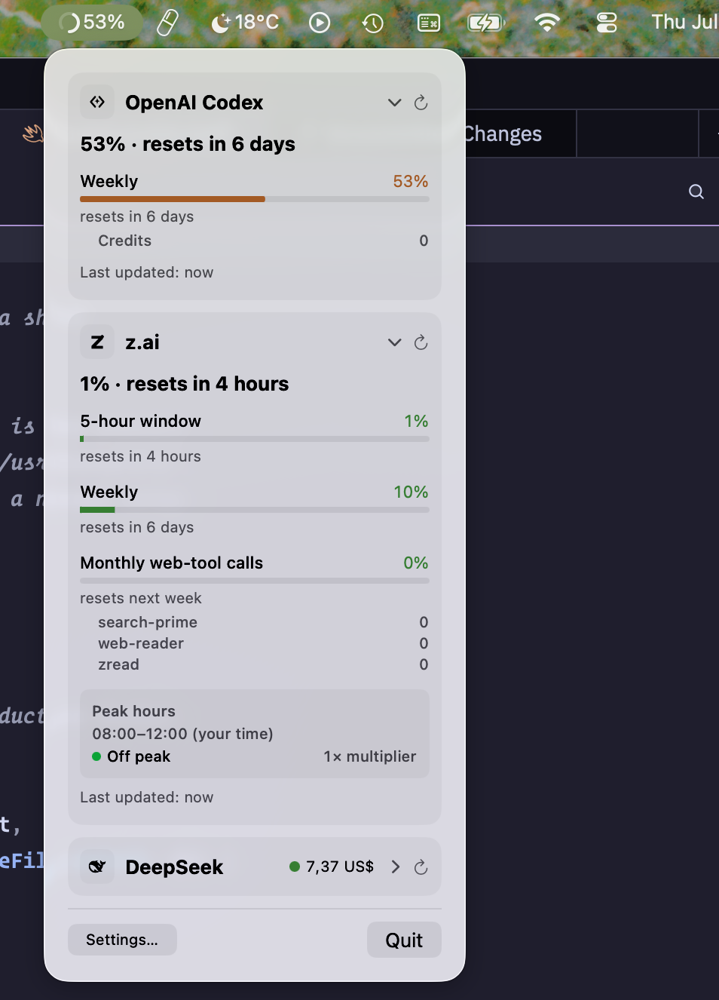
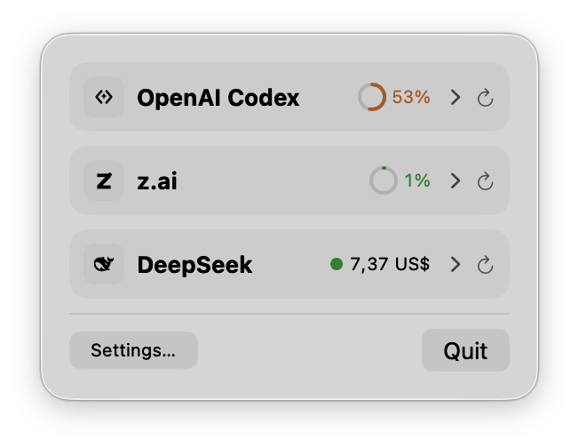
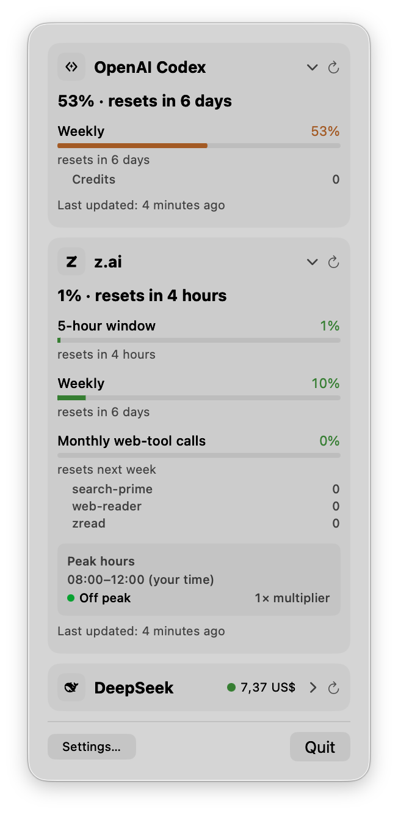

# Filbert

[](https://www.apple.com/macos/)
[](https://www.swift.org/)
[](./LICENSE)

**Website:** [victorhqc.github.io/filbert](https://victorhqc.github.io/filbert/)

<p align="center">
  
</p>

**Filbert is a native macOS AI usage tracker.** It monitors token budgets,
quotas, and spending across AI providers from a simple menu-bar app. The name
stands for **F**riendly **I**con
**L**etting **B**udgets **E**xplain **R**emaining **T**okens.

Most developers use more than one AI platform: a coding plan here, an API key
there, and a subscription somewhere else. Filbert brings them into one view, so
you do not need to open several browser tabs to see what remains.

The [website](https://victorhqc.github.io/filbert/) has the full tour:
features, screenshots, supported providers, and privacy.

<table>
  <tr>
    <td></td>
    <td></td>
    <td></td>
  </tr>
</table>

## Install

Filbert needs Apple Silicon and macOS 14 (Sonoma) or newer. It looks and works
best on macOS 26 (Tahoe).

```sh
brew install --cask victorhqc/tap/filbert
```

Or download the DMG from the
[latest release](https://github.com/victorhqc/filbert/releases/latest). Filbert
updates itself.

Read [`SETUP.md`](SETUP.md) for the DMG steps, provider setup, automatic usage
checks, and how to uninstall.

## What you get

- **Menu bar** — what is left for the provider you use right now.
- **Popover** — usage, limits, reset times, and forecasts for every provider.
- **Smart usage checks** — more frequent checks while usage changes, within
  provider rate limits.
- **Keep Mac Awake** — for a set time, or until you turn it off.

See the [features](https://victorhqc.github.io/filbert/#features) on the
website.

## Supported providers

| Provider         | What it tracks                   | What it needs           |
|------------------|----------------------------------|-------------------------|
| Claude Code      | Plan usage                       | Claude Code CLI         |
| OpenAI Codex     | Subscription usage               | Codex CLI               |
| Cursor           | Subscription and on-demand spend | Cursor sign-in          |
| Gemini CLI       | Model quotas and reset times     | Gemini CLI Google login |
| z.ai Coding Plan | GLM Coding Plan quota            | API key                 |
| z.ai API         | Pay-as-you-go balance            | API key                 |
| DeepSeek         | Prepaid balance                  | API key                 |
| Kimi API         | Prepaid balance                  | API key                 |
| Kimi Code        | Membership usage windows         | API key                 |
| OpenCode Go      | Go subscription windows          | API key                 |

Providers that read a local CLI or sign-in need a short setup. See
[Provider setup](SETUP.md#provider-setup).

## Privacy

- API keys live in the **macOS Keychain**. They are never written to disk in
  plaintext and never logged.
- Filbert calls each provider's API directly over HTTPS. There is no Filbert
  server.
- **No telemetry, no analytics, no remote logging.**

Read [Why macOS asks for your password](SETUP.md#why-macos-asks-for-your-password)
for what the Keychain prompt means.

## Documentation

| Document                               | For                                                     |
|----------------------------------------|---------------------------------------------------------|
| [`SETUP.md`](SETUP.md)                 | Install, provider setup, usage checks, logs, uninstall  |
| [`DEVELOPMENT.md`](DEVELOPMENT.md)     | Build from source, the validation gate, architecture    |
| [`CONTRIBUTING.md`](CONTRIBUTING.md)   | Spec-first workflow, coding standards, commits, PRs     |
| [`AGENTS.md`](AGENTS.md)               | Rules for AI coding agents                              |
| [`specs/`](specs/)                     | The specs that drive the work                           |
| [`docs/`](docs/)                       | Maintainer guides: signing, updates, Homebrew, l10n     |

## Status

**Early development.** The Core protocol, the Keychain wrapper, and the z.ai
Coding Plan, z.ai API, Claude, Gemini CLI, DeepSeek, Kimi API, Kimi Code,
OpenAI Codex, Cursor, and OpenCode Go providers are in place. The app builds and runs as a menu-bar item. More
providers and widgets come next.

## License

[MIT](./LICENSE) © 2026 Victor Quiroz Castro.
