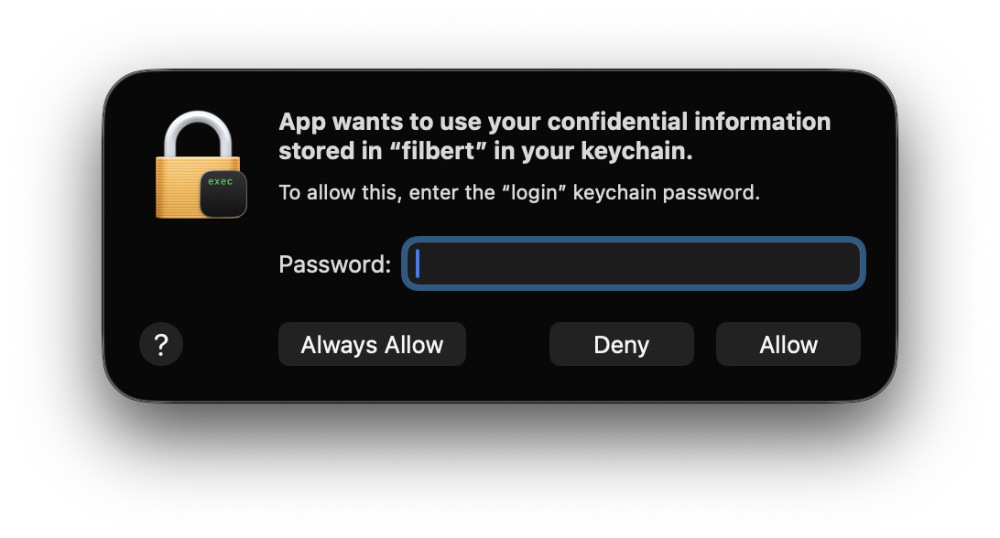

# Set up Filbert

This guide covers installing Filbert, adding providers, and the setup steps
for providers that read a local sign-in instead of an API key. For a tour of
the app, visit the [website](https://victorhqc.github.io/filbert/).

To build Filbert from source, read [`DEVELOPMENT.md`](DEVELOPMENT.md).

## Requirements

- **Apple Silicon** (M1 or newer). The released DMG is arm64-only.
- **macOS 14 (Sonoma)** or newer. Filbert looks and works best on macOS 26
  (Tahoe).
- An API key or a signed-in local CLI session for each provider you want to
  track.

## Install

### Homebrew

```sh
brew install --cask victorhqc/tap/filbert
```

Filbert updates itself, so `brew upgrade` skips it.

### DMG

1. Open the [latest Filbert release](https://github.com/victorhqc/filbert/releases/latest).
2. Under **Assets**, download `Filbert-<version>-arm64.dmg`.
3. Double-click the DMG, then drag Filbert to the `/Applications` shortcut.
4. Launch Filbert from Applications. It appears in the menu bar, not the Dock.

Every release is signed with a Developer ID and notarized by Apple.

## Add a provider

On first launch, a welcome window helps you choose a language and add your
first provider.

To add more later, click the Filbert menu-bar icon and open **Settings**. For
providers that use an API key, enter the key. The key goes straight into the
Keychain. Filbert checks usage once, then leaves further checks to
[automatic usage checks](#automatic-usage-checks), which you turn on per
provider.

## Provider setup

| Provider     | What it tracks                                             | What it needs                          |
|--------------|------------------------------------------------------------|----------------------------------------|
| z.ai         | GLM Coding Plan quota — token or credits plans, peak hours | API key                                |
| DeepSeek     | Prepaid balance — total, granted, topped-up                | API key                                |
| Kimi API     | Prepaid balance — available, voucher, cash                 | [API key](#kimi-api)                   |
| OpenCode Go  | Go subscription windows — rolling, weekly, monthly         | OpenCode API key tied to a Go plan     |
| Claude Code  | Plan usage                                                 | [Claude Code CLI](#claude-code)        |
| OpenAI Codex | Subscription usage                                         | [Codex CLI](#openai-codex)             |
| Gemini CLI   | Model quotas and reset times                               | [Gemini CLI Google login](#gemini-cli) |
| Cursor       | Subscription and on-demand spend                           | [Cursor sign-in](#cursor)              |

The OpenCode Go API reports usage percentages and reset times only, with no
dollar amounts. Filbert does not estimate spend.

### Claude Code

The Claude provider reads usage from the **Claude Code CLI** (`claude`). It does
not read from the Claude desktop app or from editor plugins like Zed's Claude
agent. Those are separate products. They share the Claude brand, but they do not
feed Filbert.

**Install the CLI.** Run this in your terminal:

```sh
curl -fsSL https://claude.ai/install.sh | bash
```

**Check it.** Open a *new* terminal so `PATH` reloads:

```sh
which claude
# expected: /Users/<you>/.local/bin/claude
```

**Log in.** Make sure `claude` is logged in. Filbert reads the usage Claude
Code already fetched for your account. It never handles your credentials.

Then open Filbert → Settings → Claude Code and click **Install Helper**. The
helper hooks into Claude Code's `statusLine` command. It writes a small cache
file that Filbert reads during a usage check.

Filbert includes the compiled helper. Installation does not require Xcode or
Command Line Tools. If installation fails, select **Show Logs**, correct the
reported problem, then select **Install Helper** again.

> **You never run anything by hand.** When you click **Check usage now**,
> Filbert runs `claude -p "/usage"` in the background. It reads the figures and
> updates the cache. This works even when you use Claude Code from an editor
> and never open its status line. During interactive sessions, the status-line
> helper keeps the cache fresh.

The Claude desktop app (`/Applications/Claude.app`) is **not** a substitute. Its
bundled `claude` binary sits under a versioned `~/Library/Application
Support/Claude/...` path that changes on every update, and it is not meant to
run on its own.

### OpenAI Codex

The OpenAI Codex provider reads subscription usage from the local `codex` CLI.
Install it, then check the version:

```sh
curl -fsSL https://chatgpt.com/codex/install.sh | sh
codex --version
```

Run `codex` from a project directory. On first launch, choose **Sign in with
ChatGPT**. Filbert does not read, store, or manage your Codex credentials.
For other install methods and troubleshooting, see the
[official Codex CLI docs](https://developers.openai.com/codex/cli/).

### Gemini CLI

The Gemini provider reads model quota and reset times from the Google login used
by the local **Gemini CLI**. It does not track Gemini API, AI Studio, Vertex AI,
or Google Cloud billing usage, and it never sends a model prompt.

Install Gemini CLI by following the
[official installation instructions](https://github.com/google-gemini/gemini-cli#installation),
then run it and choose **Login with Google**. Use the Google account associated
with the Gemini or Code Assist subscription you want to track. If Google asks
for a project, follow Gemini CLI's setup instructions before enabling the
provider in Filbert.

Filbert reads the credential Gemini CLI stores in the macOS Keychain. It does
not ask you to enter a Gemini API key, copy the credential into Filbert's
Keychain, or read the legacy `~/.gemini/oauth_creds.json` file. macOS may show
an access prompt the first time Filbert reads the Gemini CLI item.

The quota request uses Google's private `v1internal` Code Assist interface.
Google may change that interface or the credential format; if that happens,
Filbert may need an update before Gemini usage appears again. See the
[Gemini CLI authentication documentation](https://google-gemini.github.io/gemini-cli/docs/get-started/authentication.html)
for setup and troubleshooting.

### Cursor

The Cursor provider reads subscription and on-demand spend from your local
Cursor session token. It does not read from the Cursor website. You never enter
a key — Filbert finds the token that Cursor's own apps already stored on your
machine.

**Make sure you are signed in to Cursor.** The provider reads tokens from two
locations, in this order:

1. **Keychain** — service `cursor-agent`, accounts `cursor-access-token` and
   `cursor-refresh-token`. Populated by `agent login` (the Cursor CLI).
2. **SQLite** — Cursor Desktop's `state.vscdb`. Populated when you sign into
   the Cursor desktop app.

No manual setup is needed. If you're signed into the Cursor desktop app or have
run `agent login`, Filbert picks up the token on the next usage check.

> **This provider uses undocumented Cursor endpoints.** It may stop working if
> Cursor changes their API.

### Kimi API

The Kimi API provider reads the prepaid balance of a pay-as-you-go Kimi Open
Platform (Moonshot) account. It does not track Kimi membership plans or Kimi
Code.

Create an API key on the platform where you added your balance:

- **International:** [platform.kimi.ai](https://platform.kimi.ai). Balances
  are in US dollars. The default base URL works.
- **China:** [platform.kimi.com](https://platform.kimi.com). Balances are in
  yuan. In Settings, set the base URL to `https://api.moonshot.cn`.

A key only works on its own platform. A China key on the default base URL
fails with an authentication error.

## Automatic usage checks

Automatic usage checks are opt-in for each provider and run on one of two
schedules:

- **Regular** checks every provider at the shared slow interval (five
  minutes by default), whether or not usage changed.
- **Smart** starts a provider slow and moves it to the fast interval while its
  usage keeps changing. It returns the provider to slow through a time-based
  quiet window and a short cooldown. A **Keep checking** option can hold the
  fast interval for a chosen, finite period.

Provider limits and server rate limits always win. A provider with a minimum
interval is never checked more often than it allows, and a `429` or
`Retry-After` response pauses that provider until the server deadline passes.

## Why macOS asks for your password



macOS may show a system dialog asking for your login password or Touch ID when
Filbert saves or reads credentials. This is the Keychain doing its job — not the
app.

Filbert stores every API key and token in the **macOS Keychain**, the encrypted
store Safari and other Apple apps use for passwords. When an app first reads or
writes a Keychain item in a session, macOS asks you to unlock it. Think of it as
a safe's lock:

- **Your credentials stay encrypted on disk** — only the Keychain can decrypt
  them, and only after you approve it.
- **No other app can read them** — the Keychain ties each item to the app that
  created it. A random process on your machine cannot ask for Filbert's secrets.
- **Filbert never sees the process** — the app asks the Keychain to store or
  retrieve a value, and the Keychain handles encryption and access control
  itself. Filbert never touches your password or Touch ID.

You may see this prompt once per session after the app launches, when it loads
saved keys. You may see it again when you save a new key in Settings. Cursor
and Gemini CLI users see another prompt on first import because Filbert reads
tokens that their own apps stored in the Keychain. macOS is granting
permission, not asking for another set of credentials.

**In short:** macOS shows this prompt to protect your credentials. Filbert does
not receive your password or Touch ID.

## Error logs

Filbert records errors in `~/Library/Logs/Filbert/errors.log`.
Select **Show Logs** beside an error to reveal the file in Finder.
If Filbert cannot write the log, the error states that the log is unavailable.

Successful operations and ordinary setup states do not produce log records.
Records contain timestamps, operation names, and safe error codes.
Records do not contain credentials, prompts, transcripts, or raw provider responses.
Filbert retains the current log and one previous log, with a 1 MiB limit for each file.
Logs remain on your Mac unless you choose to share them.

## Uninstall

If you use Claude Code, first select **Remove Helper** in Filbert → Settings →
Claude Code, so your statusline keeps working.

- **Homebrew:** run `brew uninstall --zap --cask filbert`. This removes Filbert
  with its preferences, caches, and logs.
- **DMG:** quit Filbert, then move it from Applications to the Trash.

Your API keys stay in the Keychain. To remove them, open **Keychain Access**,
search for `filbert`, and delete the items it finds.
