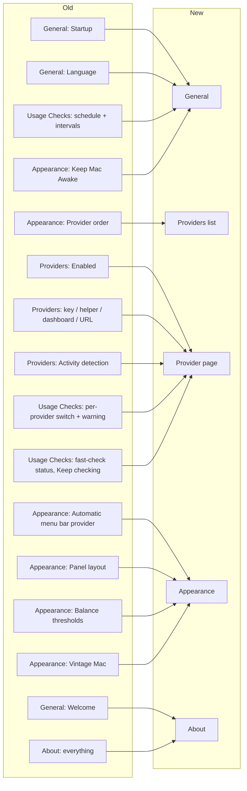

## Objective

Rebuild Settings as four tabs in native grouped forms, where each setting has exactly one home and each provider is set up on one page.

## Context

- Status: implemented 2026-11-16, uncommitted. Validation gate green. Manual check with the packaged app and native string review pending. The user accepted all four open decisions (see Plan) and asked to proceed.
- Implementation findings, 2026-11-16:
  - The Welcome window (ui 34) embeds `ProviderSetupCard`, `SettingsCard`, and `LaunchAtLoginControls`. Welcome is out of scope, so those views stay for Welcome. Settings stops using them. Welcome's "Configured" mark changes to "Ready" (AC10).
  - The selected provider is kept in `SettingsNavigation` for the app session, not saved to disk. That keeps the change out of `Sources/Core`.
  - The popover's per-provider "Open Settings" link (error state) now opens that provider's page.
  - The launch-at-login status shows as a caption under its switch, in place of a section footer.
  - Old strings that no view uses any more are removed from the App catalog (37 keys), as `StringCatalogCoverageTests` requires.
  - A catalog key made only of placeholders ("%1$@, %2$@") breaks Xcode's string-symbol generation. The list row's VoiceOver label uses the key "Provider list row accessibility label" instead.
  - Translations for the 53 new strings were machine-drafted against the glossary and deny lists. The interval labels are nouns in every language ("Prüfintervall"), because a lead-in like "alle" does not agree with "1 minute". "Tracking" / "Not tracking" and the pt-BR Keychain sentences have no confirmed source.
  - SETUP.md named the old tabs and the Regular / Smart schedules. It now describes the new layout. On 2026-11-16 the user asked to update the README too, so its feature list now says "Faster checks while you work". The site still says "Smart usage checks".
- The user asked on 2026-11-16 for a revision of Settings "as a whole". The user named Usage Checks, Appearance, and Providers as "the biggest offenders", because they are "really convoluted" and "hard to understand".
- Problems seen in the user's screenshots and in the code:
  - **A provider's settings are split across three tabs.** The "Enabled" switch, the key or helper, and activity detection are on Providers. The automatic-check switch, the quota warning, and the fast-check status are on Usage Checks. The order is on Appearance. To set up Codex fully, the user visits all three.
  - **Two switches look like one idea.** Providers has "Enabled" and Usage Checks has "Automatic usage checks", both per provider, with no hint how they differ.
  - **Usage Checks has three 60-tick sliders and a paragraph** that explains the Smart schedule in one long sentence. Slow interval has 60 stops, so 5 minutes sits at the far left.
  - **Appearance holds settings that are not appearance**: Keep Mac Awake and the menu bar provider choice.
  - **Provider cards are tall and uneven.** The status pill sits above the "Enabled" switch, the description sits below both, and the cards differ by provider type (`ProviderSettingsRow` and `APIKeyFreeSettingsRow`). Ten registered providers make a long scroll, and most of them are off.
  - **Controls are mixed.** A checkbox ("Automatic"), switches, segmented pickers with and without labels, and sliders. Labels sit left or right without a pattern.
  - **Status words differ by provider type**: "Configured" for API-key providers, "Ready" for the others, plus "Unconfigured" and "Setup needed".
  - **Long text in the page.** Several captions are two or three lines (the Smart description, the Claude Code quota warning, the hooks text).
- Current files:
  - `Sources/App/SettingsView.swift` — the `TabView` and `SettingsTab` (`general`, `providers`, `appearance`, `refresh`, `about`), frame 520–620 pt wide.
  - `Sources/App/SettingsNavigation.swift` — `SettingsDestination(tab:providerId:)` and the pending provider for deep links (ui 41 AC4).
  - `Sources/App/SettingsVisualComponents.swift` — `SettingsScrollColumn`, `SettingsCard`, `SettingsCardHeader`, `ProviderStatusPill`, `ProviderStatusPresentation`, `ProviderAccountButton`. Settings uses custom cards in place of `Form`.
  - `Sources/App/GeneralSettingsView.swift` — Startup, Language, Welcome.
  - `Sources/App/ProvidersSettingsTab.swift`, `Sources/App/ProviderSetupCard.swift`, `Sources/App/APIKeyFreeSettingsRow.swift`, `Sources/App/ActivityDetectionSection.swift` — the provider cards (ui 05, ui 14, ui 17, ui 25, ui 41).
  - `Sources/App/RefreshSettingsView.swift`, `Sources/App/RefreshSettingsProviderRow.swift`, `Sources/App/RefreshSettingsFormatting.swift` — the schedule and per-provider checks (core 08, core 11, ui 37).
  - `Sources/App/AppearanceSettingsView.swift` — order (ui 09), automatic menu bar provider (ui 23, ui 24), panel layout (ui 40), balance thresholds, Vintage Mac (ui 12), Keep Mac Awake (ui 25, ui 30, ui 35).
  - `Sources/App/AboutSettingsView.swift` — identity, project, updates (updates 04, updates 05), open source (ui 20).
  - `Sources/App/LaunchAtLoginControls.swift` — (ui 26, ui 27).
  - `Sources/App/ActivityDetectionNotice.swift` — the popover "Set Up…" button that opens Settings at a provider (ui 41 AC3, AC4).
  - `Sources/Core/AutoRefreshPreferences.swift` — the interval option lists. Slow is 1–60 minutes, fast is 10–60 seconds in steps of 5, the fast window is 2, 5, 10, or 15 minutes.
  - `Sources/App/Resources/Localizable.xcstrings`, `docs/localization-glossary.md` — every string in every shipped language (ui 29, ui 31, ui 36).
- Builds on (ui 15) and (ui 16), which this spec replaces for layout. Keeps the behavior of every spec above. Nothing in `Sources/Core` or `Sources/Providers` changes, except new provider-supplied short text if the Plan needs it (AGENTS.md §1).
- Platform is macOS 14, so `Form` with `.formStyle(.grouped)`, `LabeledContent`, and `List(selection:)` are available.

## Design

### Principles

1. **One home for each setting.** Everything about one provider is on that provider's page. Everything app-wide is on General.
2. **Native grouped forms.** The label is on the left, the control is on the right, one row per setting. This is the System Settings look, so the user already knows it.
3. **One control for each kind of choice.** A switch for on or off. A segmented control for two or three visual choices. A pop-up menu for a list of values. No sliders and no checkboxes.
4. **Short text.** A section footer is one sentence at most. A longer explanation goes behind an ⓘ button.
5. **Show only what applies.** A provider that is off shows no setup rows. Fast-check rows show only when fast checks are on.
6. **The same words everywhere.** See the glossary below.

### Tabs: before and after

```
BEFORE (5 tabs)                         AFTER (4 tabs)
───────────────────────────────         ───────────────────────────────
General      Startup                    General      Launch at login
             Language                                Language
             Welcome                                 Usage checks (schedule)
                                                     Keep Mac Awake
Providers    10 tall cards
             Enabled, key/helper,       Providers    List + one page per provider:
             dashboard, activity                     on/off, connection, dashboard,
             detection, custom URL                   automatic checks, activity
                                                     detection, custom URL, order
Appearance   Provider order
             Menu bar auto-select       Appearance   Menu bar (icon, which provider)
             Panel layout                            Panel (layout)
             Balance thresholds                      Balance colors
             Menu bar icon
             Keep Mac Awake
Usage Checks Schedule + 3 sliders       (removed — split into General
             Per-provider switches       and each provider page)
             Fast-check status
About        Identity, project,         About        Identity, updates, What's New,
             updates, open source                    welcome window, project, credits
```

### Where each setting moves



### Glossary (one name for each idea)

| Idea | Today | New |
|---|---|---|
| Provider is on (ui 17) | "Enabled" switch | Switch in the page header. VoiceOver: "Track Claude Code". List sections "Tracking" and "Not tracking" |
| Provider works | "Configured" (API key), "Ready" (API-key-free) | **Ready** for both |
| Provider needs a key or helper | "Unconfigured", "Setup needed" | **Needs setup** for both |
| Provider failed | "Error" | **Error** (unchanged) |
| Provider is off | "Disabled" | **Off** |
| Per-provider automatic checks (core 08) | "Automatic usage checks" | **Check automatically** |
| Slow interval | "Slow interval" | **Check every** |
| Smart mode (core 11) | "Smart schedule" / "Regular schedule" | **Check faster while you work** (a switch: on = Smart, off = Regular) |
| Fast interval | "Fast interval" | **Faster checks every** |
| Fast-check duration | "Fast-check duration" | **Stay fast for** |
| Smart extension (core 11 AC5) | "Keep checking" | **Keep checking fast** |
| Menu bar auto-select (ui 23) | "Automatic" checkbox | **Show usage for: Most active provider / First provider in list** |
| Vintage Mac (ui 12) | "Vintage Mac" switch | **Icon style: Ring / Vintage Mac** |
| Balance thresholds | "Balance thresholds" | **Balance colors** |

The stored values do not change. `AutoRefreshMode.regular` and `.smart` stay. Only the labels change.

### General

```
┌──────────────────────────────────────────────────────────────────────┐
│ ● ● ●                           General                              │
│          [⚙ General]  [⚿ Providers]  [◐ Appearance]  [ⓘ About]       │
├──────────────────────────────────────────────────────────────────────┤
│                                                                      │
│   ┌──────────────────────────────────────────────────────────────┐   │
│   │ Launch at login                                      [ ●━ ]  │   │
│   │──────────────────────────────────────────────────────────────│   │
│   │ Language                                   [ System    ▾ ]   │   │
│   └──────────────────────────────────────────────────────────────┘   │
│     Filbert opens in the menu bar after you sign in.                 │
│                                                                      │
│   Usage checks                                                       │
│   ┌──────────────────────────────────────────────────────────────┐   │
│   │ Check every                                [ 5 minutes ▾ ]   │   │
│   │──────────────────────────────────────────────────────────────│   │
│   │ Check faster while you work  ⓘ                       [ ●━ ]  │   │
│   │──────────────────────────────────────────────────────────────│   │
│   │     Faster checks every                   [ 45 seconds ▾ ]   │   │
│   │     Stay fast for                          [ 5 minutes ▾ ]   │   │
│   └──────────────────────────────────────────────────────────────┘   │
│     Turn checks on for each provider in Providers.  ➜                │
│                                                                      │
│   Keep Mac Awake                                                     │
│   ┌──────────────────────────────────────────────────────────────┐   │
│   │ Show Keep Mac Awake in the panel                     [ ●━ ]  │   │
│   │──────────────────────────────────────────────────────────────│   │
│   │ Remember “Until turned off”  ⓘ                       [ ●━ ]  │   │
│   └──────────────────────────────────────────────────────────────┘   │
│                                                                      │
└──────────────────────────────────────────────────────────────────────┘
```

- The two indented rows show only when "Check faster while you work" is on.
- The ⓘ next to "Check faster while you work" opens a popover with today's full Smart sentence, built from the current values.
- The launch-at-login status line, the "Open Login Items Settings" button, and errors (ui 26, ui 27) show as the footer of the first section, only when they apply. With no problem, the footer is the one-line description above.
- "Show Welcome Window" moves to About.

Pop-up values:

| Row | Presets | Rule |
|---|---|---|
| Check every | 1, 2, 5, 10, 15, 30, 60 minutes | A saved value that is not a preset (for example 7 minutes) is added to the menu, so nothing is lost |
| Faster checks every | 10, 15, 30, 45, 60 seconds | Same rule |
| Stay fast for | 2, 5, 10, 15 minutes | All existing options |

### Providers

A list on the left, one provider page on the right. The list is the provider order. Drag a row to reorder.

```
┌─────────────────────────────────────────────────────────────────────────────┐
│ ● ● ●                            Providers                                  │
│             [⚙ General]  [⚿ Providers]  [◐ Appearance]  [ⓘ About]           │
├──────────────────────┬──────────────────────────────────────────────────────┤
│ TRACKING             │                                                      │
│▐✳  Claude Code     ●▌│   ✳   Claude Code                           [ ●━ ]   │
│ ⟨⟩ OpenAI Codex    ● │       Claude Pro/Max subscription usage              │
│ 🐋 DeepSeek        ● │                                                      │
│ ⌘  Cursor          ◐ │   Connection                                         │
│                      │   ┌──────────────────────────────────────────────┐   │
│ NOT TRACKING         │   │ Status                           ● Ready     │   │
│ ✦  Gemini CLI        │   │──────────────────────────────────────────────│   │
│ K  Kimi Code         │   │ Status-line helper    Installed   [Remove]   │   │
│ K  Kimi API          │   │──────────────────────────────────────────────│   │
│ ◇  OpenCode Go       │   │ Dashboard                       [Open ↗]     │   │
│ Z  z.ai Coding Plan  │   └──────────────────────────────────────────────┘   │
│ Z  z.ai API          │                                                      │
│                      │   Usage checks                                       │
│                      │   ┌──────────────────────────────────────────────┐   │
│                      │   │ Check automatically                  [ ●━ ]  │   │
│                      │   │──────────────────────────────────────────────│   │
│                      │   │ ⚡ Fast checks, 4 min left            [Stop]  │   │
│                      │   │──────────────────────────────────────────────│   │
│                      │   │ Keep checking fast            [ Choose… ▾ ]  │   │
│                      │   └──────────────────────────────────────────────┘   │
│                      │     ⚠ Each check runs claude -p "/usage" and may     │
│                      │       use some of your Claude Code quota.  ⓘ         │
│                      │                                                      │
│ Drag to reorder.     │                                                      │
└──────────────────────┴──────────────────────────────────────────────────────┘

  ● green = Ready    ◐ orange = Needs setup    ▲ red = Error    (none) = Off
```

**The list**

- Two sections: "Tracking" (on) and "Not tracking" (off). A row has the logo, the name, and a status mark. The mark has a different shape for each state, so color is not the only signal.
- Dragging works inside "Tracking". It uses the same move logic as today, so the saved positions of providers that are off stay (ui 09).
- The first provider selected is the last one the user selected. If there is none, it is the first "Tracking" provider.

**A provider page, by state**

Codex, on and Ready, with activity detection (ui 41):

```
   ⟨⟩  OpenAI Codex                                     [ ●━ ]
       Codex subscription usage

   Connection
   ┌──────────────────────────────────────────────────────┐
   │ Status                                  ● Ready      │
   │ Dashboard                              [Open ↗]      │
   └──────────────────────────────────────────────────────┘

   Usage checks
   ┌──────────────────────────────────────────────────────┐
   │ Check automatically                          [ ●━ ]  │
   │──────────────────────────────────────────────────────│
   │ Activity detection  ⓘ               Off   [Install]  │
   │──────────────────────────────────────────────────────│
   │ Keep checking fast                   [ Choose… ▾ ]   │
   └──────────────────────────────────────────────────────┘
     Install adds Filbert's hooks to ~/.codex/hooks.json.
```

When the schedule cannot use activity detection (ui 41 AC2), the row stays and its footer reads: "Works when “Check faster while you work” is on. ➜" The arrow opens General.

DeepSeek, on, with no key yet:

```
   🐋  DeepSeek                                         [ ●━ ]
       DeepSeek API balance

   Connection
   ┌──────────────────────────────────────────────────────┐
   │ Status                            ◐ Needs setup      │
   │──────────────────────────────────────────────────────│
   │ API key   [••••••••••••••••••••••••••]     [Save]    │
   │──────────────────────────────────────────────────────│
   │ Dashboard                              [Open ↗]      │
   └──────────────────────────────────────────────────────┘
     Filbert saves the key in your Keychain.

   ▸ Advanced
```

DeepSeek, on, with a saved key, and "Advanced" open:

```
   Connection
   ┌──────────────────────────────────────────────────────┐
   │ Status                                  ● Ready      │
   │ API key                   Saved in Keychain [Remove] │
   │ Dashboard                              [Open ↗]      │
   └──────────────────────────────────────────────────────┘

   Usage checks
   ┌──────────────────────────────────────────────────────┐
   │ Check automatically                          [ ●━ ]  │
   └──────────────────────────────────────────────────────┘
     These checks are documented as not using quota.

   ▾ Advanced
   ┌──────────────────────────────────────────────────────┐
   │ Custom base URL  [https://api.deepseek.com ] [Save]  │
   │                                    [Use Default]     │
   └──────────────────────────────────────────────────────┘
```

Any provider, off:

```
   🐋  DeepSeek                                         [ ━○ ]
       DeepSeek API balance

       Turn on DeepSeek to track its usage.
       Your saved key stays in the Keychain.
```

Error (any provider): the Status row reads "▲ Error". The message goes below it as one row, with "Show Error Log" (core 10). All other rows stay, so the user can fix the key or reinstall from the same page.

### Appearance

```
┌──────────────────────────────────────────────────────────────────────┐
│ ● ● ●                         Appearance                             │
│          [⚙ General]  [⚿ Providers]  [◐ Appearance]  [ⓘ About]       │
├──────────────────────────────────────────────────────────────────────┤
│                                                                      │
│   Menu bar                                                           │
│   ┌──────────────────────────────────────────────────────────────┐   │
│   │ Icon style                          [ Ring | Vintage Mac ]   │   │
│   │──────────────────────────────────────────────────────────────│   │
│   │ Show usage for               [ Most active provider    ▾ ]   │   │
│   └──────────────────────────────────────────────────────────────┘   │
│     Now showing Claude Code.                                         │
│                                                                      │
│   Panel                                                              │
│   ┌──────────────────────────────────────────────────────────────┐   │
│   │ Layout                                 [ Stacked | Tabs ]    │   │
│   │──────────────────────────────────────────────────────────────│   │
│   │ Provider order                         Change in Providers ➜ │   │
│   └──────────────────────────────────────────────────────────────┘   │
│     Tabs shows one provider at a time.                               │
│                                                                      │
│   Balance colors                                                     │
│   ┌──────────────────────────────────────────────────────────────┐   │
│   │ Low below                                          [  5 ⇅ ]  │   │
│   │──────────────────────────────────────────────────────────────│   │
│   │ OK at or above                                     [ 20 ⇅ ]  │   │
│   │──────────────────────────────────────────────────────────────│   │
│   │ ● under 5      ● 5–20      ● 20 and up                       │   │
│   └──────────────────────────────────────────────────────────────┘   │
│     Applies to every currency.                                       │
│                                                                      │
└──────────────────────────────────────────────────────────────────────┘
```

- "Show usage for" has two options. "Most active provider" is today's Automatic on (ui 23, ui 24). "First provider in list" is Automatic off. The footer names the provider shown now.
- With no provider set up, the Menu bar footer reads "Set up a provider in Providers. ➜".

### About

```
┌──────────────────────────────────────────────────────────────────────┐
│ ● ● ●                            About                               │
│          [⚙ General]  [⚿ Providers]  [◐ Appearance]  [ⓘ About]       │
├──────────────────────────────────────────────────────────────────────┤
│                                                                      │
│   ┌──────────────────────────────────────────────────────────────┐   │
│   │  ┌──────┐   Filbert                                          │   │
│   │  │ (••) │   A native macOS AI usage tracker.                 │   │
│   │  └──────┘   Version 0.27.0 (142)                             │   │
│   └──────────────────────────────────────────────────────────────┘   │
│                                                                      │
│   Updates                                                            │
│   ┌──────────────────────────────────────────────────────────────┐   │
│   │ Check for updates automatically                      [ ●━ ]  │   │
│   │──────────────────────────────────────────────────────────────│   │
│   │ Check now                          [Check for Updates…]      │   │
│   │──────────────────────────────────────────────────────────────│   │
│   │ What's New                                    [Show…]        │   │
│   │──────────────────────────────────────────────────────────────│   │
│   │ Welcome window                                [Show…]        │   │
│   └──────────────────────────────────────────────────────────────┘   │
│                                                                      │
│   Project                                                            │
│   ┌──────────────────────────────────────────────────────────────┐   │
│   │ Source code                               GitHub ↗           │   │
│   │ License                                   MIT ↗              │   │
│   │ ▸ Acknowledgements                                           │   │
│   └──────────────────────────────────────────────────────────────┘   │
│                                                                      │
└──────────────────────────────────────────────────────────────────────┘
```

"Acknowledgements" is collapsed. It holds the Sparkle and Simple Icons credits from (ui 20).

## Acceptance Criteria

### AC1: Settings has four tabs

- **Given** the user opens Settings
- **Then** the toolbar shows General, Providers, Appearance, and About, in that order
- **And** there is no Usage Checks tab
- **And** a saved selection of the old Usage Checks tab opens General.

### AC2: Every tab uses a native grouped form

- **Given** any tab is open
- **Then** its content is a `Form` with `.formStyle(.grouped)`, with labels on the left and controls on the right
- **And** on/off settings use switches, two- or three-way visual choices use segmented controls, and value lists use pop-up menus
- **And** no tab uses a slider or a checkbox
- **And** no section footer is longer than one sentence. Longer text is behind an ⓘ button with a VoiceOver label.

### AC3: General holds the app-wide settings

- **Given** General is open
- **Then** it shows Launch at login and Language in the first section, then Usage checks, then Keep Mac Awake, as in the Design mockup
- **And** Launch at login keeps its status, approval button, and errors (ui 26, ui 27)
- **And** Keep Mac Awake keeps both switches and the disabled state of the second one (ui 25, ui 35).

### AC4: Usage checks uses pop-up menus and one switch

- **Given** the Usage checks section on General
- **Then** "Check every" is a pop-up menu with the presets from the Design table
- **And** "Check faster while you work" is a switch: on saves `AutoRefreshMode.smart`, off saves `.regular`
- **And** "Faster checks every" and "Stay fast for" show only while that switch is on
- **And** the ⓘ popover shows the full schedule sentence with the current values (ui 37)
- **And** the footer link opens Providers.

### AC5: A saved value that is not a preset stays

- **Given** the saved slow interval is 7 minutes, or the fast interval is 25 seconds
- **When** General opens
- **Then** the pop-up menu shows that value as selected, in order among the presets
- **And** the value does not change until the user picks another one.

### AC6: Providers shows a list and one provider page

- **Given** Providers is open
- **Then** the left side lists every registered provider in two sections, "Tracking" (on) and "Not tracking" (off)
- **And** each row shows the logo, the name, and a status mark for Ready, Needs setup, or Error, with a different shape for each
- **And** the right side shows the selected provider's page
- **And** the tab opens on the provider selected last, or the first "Tracking" provider.

### AC7: The list sets the order

- **Given** two or more providers under "Tracking"
- **When** the user drags a row, or uses the "Move up" and "Move down" VoiceOver actions
- **Then** the order changes in the popover and for the menu bar, as in (ui 09)
- **And** saved positions of providers that are off do not change
- **And** Appearance no longer has an order list.

### AC8: A provider page holds all of that provider's settings

- **Given** a provider that is on
- **Then** its page shows a header (logo, name, description, on/off switch), a Connection section, a Usage checks section, and Advanced when the provider has a base URL (ui 03)
- **And** Connection shows the status, the API key or helper rows that apply, and Dashboard when the provider has one (ui 25)
- **And** Usage checks shows "Check automatically", the provider's quota note, the fast-check status and "Stop" when fast checks run, "Keep checking fast", and Activity detection when the provider supports it (ui 41)
- **And** every action from today's cards and today's Usage Checks rows is on the page, with the same behavior: save and remove key, install and remove helper, credential import, custom base URL, error-log link, start and stop fast checks
- **And** the provider's `disclaimer` shows as the page's last footer.

### AC9: A provider that is off shows only its header

- **Given** a provider that is off
- **When** its page opens
- **Then** it shows the header and one line that says how to turn it on and that saved keys stay
- **And** no setup, check, or activity rows show
- **And** turning it on shows the full page without leaving the tab.

### AC10: Status words are the same for every provider

- **Given** any provider page or list row
- **Then** the status reads Ready, Needs setup, Error, Off, or Working…
- **And** API-key and API-key-free providers use the same words.

### AC11: Appearance holds only display settings

- **Given** Appearance is open
- **Then** it shows Menu bar (Icon style, Show usage for), Panel (Layout, link to the order), and Balance colors, as in the Design mockup
- **And** "Show usage for: Most active provider" maps to automatic selection on, and "First provider in list" maps to off (ui 23, ui 24)
- **And** the Menu bar footer names the provider the menu bar shows now.

### AC12: About holds identity, updates, and credits

- **Given** About is open
- **Then** it shows the identity block, Updates (automatic switch, check now, What's New, Welcome window), and Project (source, license, Acknowledgements)
- **And** update controls keep their disabled states in a build without Sparkle (updates 04).

### AC13: Deep links still land on the right place

- **Given** the popover "Set Up…" button for a provider (ui 41 AC4), or any other link that opens Settings at a provider
- **When** Settings opens or is already open
- **Then** Providers is selected, that provider is selected in the list, and its page scrolls to the Activity detection row
- **And** VoiceOver focus moves to that row
- **And** any link that opened the old Usage Checks tab opens General at the Usage checks section.

### AC14: No setting is lost

- **Given** a user upgrades with saved preferences, keys, helpers, and hooks
- **When** Settings opens
- **Then** every saved value shows as before, with no migration and no change to stored keys or `UserDefaults` keys
- **And** every setting from today's Settings is reachable in the new one.

### AC15: Strings are localized and old strings are removed

- **Given** the new and changed labels from the glossary
- **Then** every one is in `Localizable.xcstrings` for every shipped language (ui 31, ui 36)
- **And** `docs/localization-glossary.md` lists the new terms and drops the old ones
- **And** strings that no view uses any more are removed from the catalog.

### AC16: The window fits the new layout

- **Given** Settings at its minimum size
- **Then** the Providers list and page both fit without clipping at 680 × 460 pt
- **And** the window still resizes, and every tab scrolls when its content is taller than the window.

### AC17: Accessibility holds

- **Given** VoiceOver, Increase Contrast, Reduce Motion, or the largest text size
- **Then** every control has a label that names its provider when it is on a provider page (for example "Check Claude Code automatically")
- **And** status marks have VoiceOver labels and do not depend on color
- **And** no row truncates its label at the minimum window size in any shipped language.

## Plan

Planned as four PRs. On 2026-11-16 the user asked for the whole implementation at once, so the four steps landed together in one working tree.

1. [x] **Form primitives and status words.** Add a small set of shared views in `SettingsVisualComponents.swift`: a provider page header, a status mark, an info button with a popover, and a value pop-up built from an option list plus the saved value (AC5). Replace `ProviderStatusPresentation` labels with the AC10 words. Unit-test the option list and the status mapping.
2. [x] **General and Appearance.** Rebuild General with `Form(.grouped)` and the Usage checks and Keep Mac Awake sections. Rebuild Appearance without order and Keep Mac Awake. Delete `RefreshSettingsView.swift` and the `refresh` tab. Map old `.refresh` destinations to `.general` (AC13). Per-provider check switches stay reachable through the old cards until step 3.
3. [x] **Providers list and page.** Replace `ProvidersSettingsTab` with an `HStack` of a `List(selection:)` (sections, drag, VoiceOver move actions) and a provider page in a `Form`. Merge `ProviderSettingsRow`, `APIKeyFreeSettingsRow`, the useful parts of `RefreshSettingsProviderRow`, and `ActivityDetectionSection` into page sections. Keep `APIKeyFreeManagementAction` so each action shows once (ui 41 AC8). Store the selected provider ID in `SettingsNavigation` for the session (see Context findings). Move deep-link reveal from "scroll and highlight a card" to "select and scroll to the row". Delete `RefreshSettingsProviderRow.swift`. `ProviderSetupCard.swift` stays for the Welcome window.
4. [x] **About, strings, and clean-up.** Rebuild About. Add and remove strings in every language and update the glossary. Remove `SettingsScrollColumn`. `SettingsCard` stays for the Welcome window. Set the window size from AC16.

Manual check after step 4, with the packaged app: each tab in English and in the longest language (German), light and dark, Increase Contrast, VoiceOver through one provider page, the "Set Up…" deep link, and an upgrade from a profile with a custom slow interval and a custom base URL.

Decisions (the user accepted every recommendation on 2026-11-16):

1. Rename "Smart schedule" to "Check faster while you work". **Recommended**, because a switch with a plain name explains itself. It also changes the popover and activity-detection text that says "Smart" (ui 41 AC2). The alternative keeps the words "Regular / Smart" in a segmented control.
2. List and page side by side. **Recommended**, because it is how Mail and Internet Accounts show accounts, and deep links can select a row. The alternative is a list that pushes to a page with a back button, which fits a narrower window but hides the list.
3. Show "Not tracking" providers in the list. **Recommended**, so the user can find providers. The alternative is an "Add Provider…" button.
4. Keep Mac Awake on General. **Recommended**. It is an app behavior, not a display setting.

## Risks

- **Settings and `List(selection:)`.** SwiftUI `Settings` scenes have had layout bugs with split views. The Plan uses an `HStack` and a plain `List`, not `NavigationSplitView`. Check tab switches and window resize early in step 3.
- **Window width.** The minimum grows from 520 to 680 pt. A user with a small display or a saved narrow frame sees a wider window.
- **Deep-link timing.** On first open, Settings builds its views after the destination is set (`SettingsNavigation.pendingProviderId`). The new list must take the pending ID after it appears, as today.
- **Lost translations.** Most labels change. Every language needs new strings and a native review before release. The What's New entry for the release should explain the new layout.
- **Muscle memory.** Users who know the Usage Checks tab will not find it. The General footer and the provider page footers link across, and the release highlights should mention the move.
- **Hidden behavior change.** A switch in place of a segmented control must still call `setAutoRefreshMode`, so fast-check state resets as it does today (core 11).
- **Drag inside a `List` with sections.** Drag must stay inside "Tracking". A drop on "Not tracking" must do nothing, not turn a provider off.
- **`QuotaViewModel` size.** Its class body is at SwiftLint's limit (ui 41). New state, such as the selected provider, goes in an extension or a small store.
- **Text length.** German and Russian labels are longer. Pop-up menus and switches take less room than today's sliders, but long row labels can still wrap. AC17 covers it.
